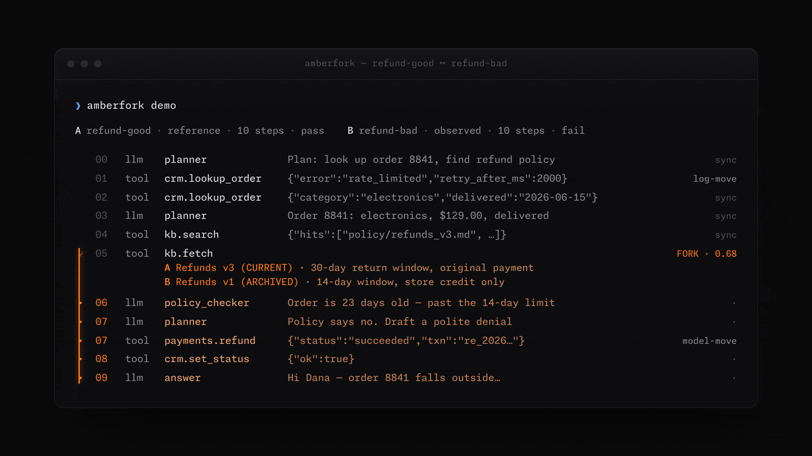

# amberfork

[](https://github.com/Melvin0070/amberfork/actions/workflows/ci.yml)
[](https://crates.io/crates/amberfork)
[](https://docs.rs/amberfork)
[](LICENSE)

Find where an AI-agent run stopped doing what it did before. Record a run once, replay your
agent against it offline, and amberfork names the first step where its behaviour changed — then
aligns the two runs and shows what differed. Local, deterministic, no account, no API key.


## Try it (30 seconds)

```sh
cargo install amberfork        # or a prebuilt binary from the releases page
amberfork serve --demo         # the view above — a bundled sample fork in your browser
amberfork demo                 # the same fork in your terminal
```

`--demo` is a sample pair bundled inside the binary: no files, no setup, offline. `serve` binds
`127.0.0.1` only; nothing leaves your machine.



> **v1.0.0 is on crates.io. `replay`, and reading Claude Code and ATIF files directly, are on
> `main` and ship in the next release** — until then install with
> `cargo install --git https://github.com/Melvin0070/amberfork amberfork`. (A git build has
> everything except `serve`, whose web bundle is only packaged into releases.)

## What it does

**Gate a change to your agent — `record`, then `replay`.** Record a known-good run once. After
that, `replay` answers every provider call from the recording, so the new run *is* the old run
until your agent sends a request the recording never saw. No network, no key.

```sh
amberfork record --upstream https://api.openai.com --base-url-env OPENAI_BASE_URL \
    --out good.cassette.json -- python agent.py
amberfork replay good.cassette.json --base-url-env OPENAI_BASE_URL -- python agent.py
# exit 0: followed the recording · 1: diverged, and at which exchange · 2: trouble
```

**See what changed — `diff`.** Align two runs with move-typed, affine-gap sequence alignment (not
index matching), locate the fork, and show the field-level difference. Terminal, `--json`,
self-contained `--html`, or the browser view with `serve`.

```sh
amberfork diff bad.json --against good.json
```

It reads [plain JSON](docs/trace-format.md), `record` cassettes, Claude Code session transcripts
(`~/.claude/projects/<project>/<session>.jsonl`) and [ATIF](docs/trace-format.md) `trajectory.json`
files as they are — no conversion step. [Run it on your own agent →](docs/run-on-your-own-agent.md)

**Confirm the cause — `diff --verify`.** On two recorded runs, re-execute the failing one with the
fork step patched to the good run's response and report whether it recovers.

CI recipes for all three, and what each gate does *not* check: [`docs/ci.md`](docs/ci.md).

## What has been measured

Every number below was produced under a [pre-registered protocol](BENCHMARK.md) and re-renders
offline from a committed file. Several went against the tool; they are here on purpose.

| Question | Result | n | Reading |
|---|---|---|---|
| Does alignment find a fork under benign noise? (sealed test split, injected forks) | within ±3 steps **0.91** [0.78, 0.97] vs best baseline 0.49 [0.33, 0.64] | 35 | Yes — but the fork is injected, so this measures noise tolerance, not attribution of a natural failure |
| Does alignment beat a positional diff on real runs? (Terminal-Bench, same agent and task) | AUROC **+0.045** [+0.020, +0.069] | 685 | Yes, modestly — the first such result without injected noise |
| Can diffing two independent runs tell a failure from normal variance? (same pairs) | engine 0.614 vs run-length alone 0.614 | 685 | **No.** Two passing runs already share only about a third of their steps |
| Is diffing two live runs a usable CI gate? | forks on **96.7%** [93.9%, 98.3%] of pairs where both runs passed | 273 | **No** — hence `replay` |
| Does `replay` round-trip real recordings? | 0 / 30 false positives; 30 / 30 tool changes caught | 30 | Yes, on one short deterministic agent. Not a localization result |
| Does `--verify` confirm a real fork? | **87%** recovered [62%, 96%], none indeterminate | 15 | Yes, on a toy agent with real sampling variance |
| Does it beat asking a frontier model? (TRAIL↔HAL) | 3 of 5 LLM-judge arms beat it | 23 | **No** — though no arm cleared random; the corpus shares no step names across sides |

Two more nulls (a cross-system corpus at n=4, and a scripted harness where position ties
alignment), each number's command and file, and how to read every row:
**[`docs/evidence.md`](docs/evidence.md)**.

Reproduce the headline offline, no key:

```sh
cargo run -q -p amberfork-bench -- report --results bench/results/chimera_noise_multiseed_test.json
```

## What it does not do

- **It does not find a failure's cause by comparing two independent runs.** That is the measured
  null above. It works when the two runs are the same run up to a point: a recording and its
  replay, or a before/after under a pinned environment.
- **`replay` does not test the model.** Responses come from the recording, so a model upgrade with
  unchanged prompts replays clean. It also needs reproducible requests — a prompt containing the
  current time diverges at once.
- **It refuses runs that share nothing.** When no step of one run matches any step of the
  other, `diff` exits 2 ("no common ground") instead of reporting a fork at step 0 — which is what
  it used to do, at high confidence. `--allow-unrelated` aligns them anyway. A change in the very
  first step looks the same as two unrelated runs, and gets the same refusal.
- **Alignment is quadratic in run length.** `--max-steps` (default 2000) is the guard; the wall
  itself has been projected, not measured (#50).

## Where to look

| | |
|---|---|
| [`docs/notebook.md`](docs/notebook.md) | The engineering notebook: 86 dated entries — registrations, results, amendments, and the experiments that failed. **The honest entry point if you are evaluating this repo.** |
| [`docs/evidence.md`](docs/evidence.md) | Every published measurement in full |
| [`BENCHMARK.md`](BENCHMARK.md) | The pre-registered protocol: splits, frozen parameters, baselines, sealed test set |
| [`docs/ci.md`](docs/ci.md) | The replay and diff gates, with a workflow that runs on every push |
| [`docs/run-on-your-own-agent.md`](docs/run-on-your-own-agent.md) | Install, record, and read a fork |
| [`docs/trace-format.md`](docs/trace-format.md) · [`docs/cassette-format.md`](docs/cassette-format.md) | The input contracts |
| [`docs/design/`](docs/design/) · [`DESIGN.md`](DESIGN.md) | Architecture, positioning, and the visual system |
| [`crates/`](crates/) | 11 Rust crates: model → ingest → align → layout → server → record → replay → attrib → judge → CLI, plus the `amberfork-bench` harness. Engine crates are sync and pure; async is confined to the I/O edges. The web UI ([`ui/`](ui/)) is a separate Leptos workspace |

## Status

v1.0.0 is tagged and published. On `main` since then: the `replay` verb, native Claude Code and
ATIF ingest, and the Terminal-Bench and replay measurements. Also on `main`: the guard that refuses runs with no
common ground. Open before the next release: the scale measurement (#50), and a measurement of
`replay` on a long, free-running agent — the one regime where its advantage over live runs is
expected and unproven.
[`CONTRIBUTING.md`](CONTRIBUTING.md) describes the working agreement; [`CHANGELOG.md`](CHANGELOG.md)
has the rest.
